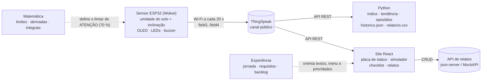
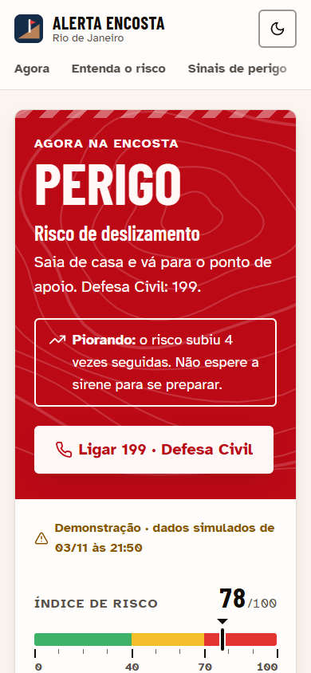
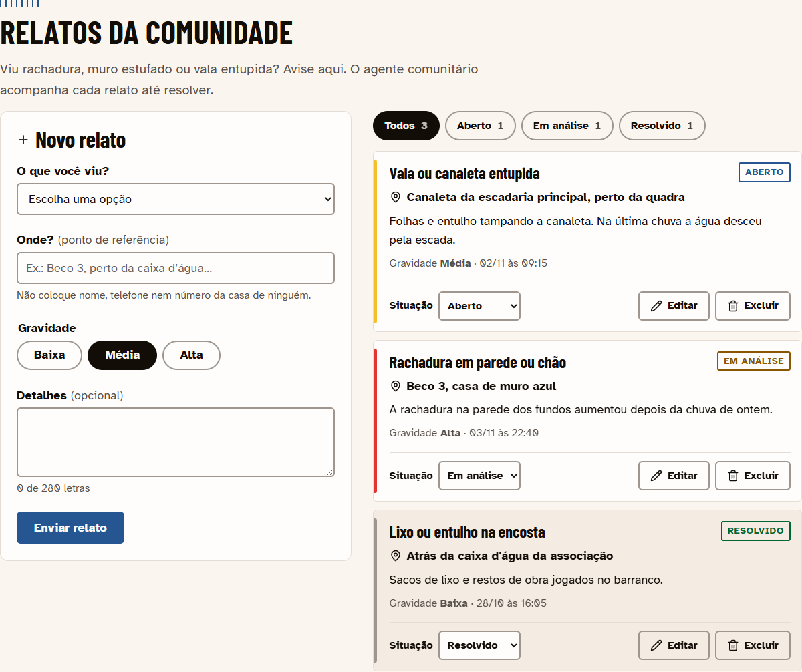

# Interface + Interação · Alerta Encosta (web)

**Front-end Design** (Aplicação Web Funcional) e **Web Development** (Interatividade e Funcionalidades Dinâmicas), no mesmo repositório, como pede o enunciado.

Site em **React + Vite** onde o morador de encosta vê, em 3 segundos, se está seguro e o que fazer agora. A cor da placa muda com o risco que o sensor mede na encosta.

| | |
|---|---|
| Site publicado | **TODO:** link do deploy (Vercel/Netlify), se houver |
| Vídeo pitch | **TODO:** link do YouTube (não listado) |


> **CitizenTech da Minha Cidade** · FIAP Global Solution 2026.2 · Engenharia de Software, 1º ano · Rio de Janeiro. Este repositório é a parte **Interface + Interação (Front-end Design e Web Development)**. Cada disciplina tem a sua entrega; a Ficha abaixo é a mesma em todas.

## Ficha da CitizenTech

| | |
|---|---|
| **Nome da CitizenTech** | Alerta Encosta |
| **Cidade e bairro** | Rio de Janeiro · Morro do Borel, Tijuca (comunidade de referência dos depoimentos públicos usados na pesquisa) |
| **Cidadão beneficiado** | Morador de comunidade em encosta com risco de deslizamento, principalmente idosos e famílias que dormem em casa durante a chuva; e o agente comunitário de Defesa Civil (NUDEC) que avisa os vizinhos |
| **Problema, em uma frase** | Em noite de chuva forte, o morador de encosta não sabe se o barranco atrás da casa está no limite, e a sirene só considera a chuva da região, não o solo daquela encosta |
| **Como funciona** | Um ESP32 na encosta mede umidade do solo e inclinação do terreno, calcula um Índice de Risco (0 a 100) e acende verde / amarelo / vermelho. Os dados vão para o ThingSpeak; um programa em Python analisa a tendência e o histórico; um site mostra ao morador o que fazer e recebe relatos da comunidade |
| **O que cada parte faz** | **Sensor:** mede e reage sozinho · **Lógica:** busca os dados, calcula o risco, detecta "piorando" e guarda histórico · **Matemática:** calcula quanto tempo a família tem antes de o solo ficar crítico e define o limiar do alerta · **Interface + Interação:** site que mostra o risco, simula, orienta e registra relatos · **Experiência:** jornada do morador, requisitos e backlog · **Pitch:** vídeo de 3 min |
| **Repositórios** | Site (Front-end Design + Web Development): **TODO** link · Sensor (Edge Computing): **TODO** link · Lógica (Computational Thinking with Python): **TODO** link |
| **Indicador de impacto** | Minutos de antecedência entre o alerta de ATENÇÃO e o solo crítico (meta ≥ 60 min; o modelo dá 1h51) · % de moradores da área que confirmam ter recebido o alerta · relatos de risco resolvidos por mês |
| **ODS conectados** | **11** (meta 11.5: reduzir mortes e pessoas afetadas por desastres, protegendo os mais vulneráveis) · **13** (meta 13.1: resiliência a riscos climáticos; 13.3: alerta precoce e educação) · **10** (as áreas de risco concentram famílias de baixa renda) |

## Integrante

| Nome completo | RM | Turma |
|---|---|---|
| Victor Lopes Tavares da Fonseca | 571315 | 1ESSRA-2026 |

## Como as partes conversam



**Uma fórmula só, em três lugares.** O Índice de Risco é o mesmo no ESP32, no Python e no site. O morador vê a mesma faixa no OLED, no terminal do agente e no celular:

```
nivel = (valor - min) / (max - min) * 100          limitado entre 0 e 100
risco = 0,6 * nivel_umidade  +  0,4 * nivel_inclinacao
NORMAL < 40  ·  ATENÇÃO 40 a 70  ·  PERIGO >= 70
umidade do solo: 30 a 90 %      inclinação: 0 a 10°
```

---

## Como rodar

Precisa do **Node 20.19+** (ou 22.12+).

```bash
npm install
cp .env.example .env        # no Windows: copy .env.example .env
npm run dev:tudo            # sobe a API (porta 3001) e o site (porta 5173) juntos
```

Abra <http://localhost:5173>.

| Comando | O que faz |
|---|---|
| `npm run dev` | Só o site |
| `npm run api` | Só a API de relatos (json-server lendo `db.json`) |
| `npm run dev:tudo` | Os dois juntos |
| `npm run build` | Gera a versão de produção em `dist/` |

### Variáveis (`.env`)

| Variável | Para quê |
|---|---|
| `VITE_API_URL` | Onde está a API dos relatos. Local: `http://localhost:3001`. Na nuvem: URL do MockAPI |
| `VITE_THINGSPEAK_CHANNEL_ID` | Canal onde o ESP32 publica. **Vazio = dados de demonstração** |
| `VITE_THINGSPEAK_READ_KEY` | Só se o canal for privado |
| `VITE_LOCAL` | Bairro mostrado no topo |

### API externa na nuvem (MockAPI), para o site publicado

1. Crie um projeto em <https://mockapi.io> e um recurso chamado **`relatos`** com os campos `tipo`, `local`, `gravidade`, `descricao`, `status`, `criadoEm` (todos *String*).
2. Cole a URL base em `VITE_API_URL` (ex.: `https://6720abcd.mockapi.io/api/v1`).

O código não muda: json-server e MockAPI seguem o mesmo padrão REST (`GET/POST /relatos`, `PUT/DELETE /relatos/:id`).

---

## O que a página faz

| Seção | O que o cidadão faz | Dado |
|---|---|---|
| **Agora na encosta** | Vê a faixa (NORMAL / ATENÇÃO / PERIGO), o que fazer, a régua de risco, umidade, inclinação e a linha do tempo. Em PERIGO aparece o botão **Ligar 199** | ThingSpeak (GET), atualiza a cada 20 s |
| **Entenda o risco** | Mexe em dois controles e vê o risco calculado na hora, com a conta aberta | Fórmula local |
| **Sinais de perigo** | Marca o que vê em casa (rachadura, porta emperrando…) e recebe orientação | Regra local |
| **Relatos da comunidade** | **Cria, lê, edita, muda a situação e exclui** relatos de sinais de risco | API externa (CRUD) |
| **Contatos e preparo** | Liga para 199/193/192 com um toque, cadastra alerta por SMS (40199), vê a mochila de emergência | Fixo |
| **Modo claro/escuro** | Botão no topo; lembra a escolha | localStorage |

### Sem internet boa?

A placa usa um plano B em camadas, e diz no topo de onde veio a leitura:

1. **Ao vivo:** o ThingSpeak respondeu, com a data e a hora da leitura.
2. **Sensor parado:** o ThingSpeak respondeu, mas a leitura mais nova tem mais de 5 minutos (o ESP32 publica a cada 20 s). O topo avisa que a faixa pode estar velha e manda seguir a sirene e a Defesa Civil.
3. **Sem internet:** mostra a última leitura guardada no aparelho (localStorage).
4. **Demonstração:** canal não configurado, ou primeira visita sem conseguir falar com o sensor; usa os dados simulados do programa em Python. Com canal configurado, o botão **Atualizar** continua na tela para tentar de novo.

As fontes vão empacotadas com o site (não dependem do Google Fonts).

---

## Organização do código (separação de responsabilidades)

```
src/
├── config.js              ← lê o .env
├── domain/                ← LÓGICA DE NEGÓCIO (funções puras, sem React)
│   ├── risco.js           ← índice de risco, faixas, tendência (mesma fórmula do ESP32 e do Python)
│   ├── relatos.js         ← tipos, validação, bloqueio de dado pessoal, ordenação
│   ├── sinais.js          ← checklist e avaliação dos sinais
│   └── formatos.js        ← números e horas no padrão brasileiro
├── services/              ← ACESSO AOS DADOS (fetch, localStorage)
│   ├── http.js            ← fetch com timeout e erros em português
│   ├── thingspeakApi.js   ← GET das leituras do sensor
│   ├── relatosApi.js      ← CRUD dos relatos
│   └── cacheLeituras.js   ← última leitura guardada no aparelho
├── hooks/                 ← CUSTOM HOOKS (estado + efeitos)
│   ├── useLeiturasEncosta.js  ← busca, atualiza a cada 20 s (pausa com a aba escondida), plano B
│   ├── useRelatos.js          ← estado dos relatos + criar/editar/mudarStatus/remover
│   ├── useFormRelato.js       ← valores, validação, envio e mensagens do formulário
│   └── useTema.js             ← claro/escuro, aplica no <html> e salva a escolha
├── components/            ← APRESENTAÇÃO (só recebem props e desenham)
│   ├── PainelAgora, FonteDados, ReguaRisco, GraficoRisco, CurvasDeNivel
│   ├── SimuladorRisco, ChecklistSinais
│   ├── SecaoRelatos, FormRelato, CartaoRelato
│   └── Cabecalho, BotaoTema, Marca, Icone, Contatos, Rodape
├── data/leituras-demo.json ← dados SIMULADOS (mesmos do backup.json do Python)
└── styles/                ← tokens.css (cores, fontes, espaços), base.css, app.css
```

Regra seguida: **componente não faz `fetch`** e **hook não desenha**. Se a API mudar, só `services/` muda; se a fórmula mudar, só `domain/risco.js` muda.

### Hooks usados

`useState`, `useEffect`, `useMemo`, `useCallback`, `useRef` + **4 custom hooks** (`useLeiturasEncosta`, `useRelatos`, `useFormRelato`, `useTema`).

Três cuidados que valem explicar na apresentação:

- **Resposta velha não sobrescreve resposta nova** (`useLeiturasEncosta`). Cada busca ganha um número guardado num `useRef`. Se o morador toca em "Atualizar" enquanto a busca automática ainda espera o ThingSpeak, a resposta que chegar por último, mas for de um pedido mais antigo, é ignorada. O `useRef` guarda o número sem redesenhar a tela.
- **Aba escondida não busca** (`useLeiturasEncosta`). Com o celular bloqueado, a atualização de 20 s pausa; quando a pessoa volta para a página (evento `visibilitychange`), busca na hora em vez de esperar até 20 s.
- **Foco no primeiro erro** (`useFormRelato`). Ao enviar o formulário com erro, o cursor vai para o primeiro campo errado, na ordem da tela: quem usa teclado ou leitor de tela cai direto no que precisa corrigir.

---

## Web Development: as interações em JavaScript

| # | Interação | Conceitos | Onde |
|---|---|---|---|
| 1 | **Modo claro/escuro** | função, evento de clique, **manipulação do DOM** (`document.documentElement.dataset.theme`), condicional, `localStorage` | `hooks/useTema.js`, `components/BotaoTema.jsx`, `styles/tokens.css` |
| 2 | **Simulador de risco** | funções, operadores aritméticos, `Math.min/max`, **condicionais** (`if risco >= 70`) | `components/SimuladorRisco.jsx`, `domain/risco.js` |
| 3 | **Checklist de sinais** | arrays (`filter`, `includes`), operador ternário, condicionais | `components/ChecklistSinais.jsx`, `domain/sinais.js` |
| 4 | **Formulário de relato** | validação com condicionais, expressão regular (bloqueia telefone/CPF), mensagens de erro | `hooks/useFormRelato.js`, `domain/relatos.js` |
| 5 | **Filtro e exclusão com confirmação** | estado, eventos, renderização condicional | `components/SecaoRelatos.jsx`, `components/CartaoRelato.jsx` |

Como o tema funciona, passo a passo:

1. O clique chama `alternarTema()`, que troca `'claro'` ↔ `'escuro'`.
2. O `useEffect` escreve `data-theme="dark"` (ou `light`) na tag `<html>`.
3. Em `tokens.css`, `:root[data-theme='dark'] { color-scheme: dark }` faz todas as cores `light-dark(...)` trocarem de uma vez.
4. A escolha fica no `localStorage`; um script em `index.html` aplica antes de desenhar, para não piscar.

---

## Acessibilidade e quem vai usar

- Corpo de texto em 18 px com a fonte **Atkinson Hyperlegible**, criada para pessoas com baixa visão.
- Contraste medido (sem alertas da verificação automática, nos dois temas).
- Alvos de toque com 44 px ou mais; telefones são links `tel:` (um toque liga).
- Linguagem simples: "Saia de casa", não "evacuação preventiva".
- Faixa anunciada para leitor de tela (`aria-live`), régua com `role="meter"`, erros ligados aos campos (`aria-describedby`), link "pular para o conteúdo".
- Respeita "reduzir movimento" do sistema.
- **Dados com cuidado:** o formulário recusa telefone/CPF e pede ponto de referência, não endereço.

## Testes feitos

Teste ponta a ponta no Chrome (headless), com a API local rodando:

- página carrega 3 relatos e a placa;
- validação (campo vazio e telefone recusado);
- **CREATE, UPDATE (editar e mudar situação), DELETE** conferidos na tela e na API;
- filtro por situação, simulador (90 % e 4° = 76 PERIGO), checklist e troca de tema;
- nenhum erro no console.

Capturas conferidas em celular (390 px) e desktop (1440 px), claro e escuro, nas três faixas.

## Evidências

| Celular (390 px) | Relatos da comunidade |
|---|---|
|  |  |

## Entregáveis desta parte

- [x] Repositório GitHub (este; o mesmo para Front-end Design e Web Development)
- [ ] Arquivo ZIP do projeto, sem `node_modules`: depois do último commit, rode `git archive --format=zip -o ../alerta-encosta-site.zip HEAD`
- [x] `README.md` (este arquivo)
- [x] [`AI.md`](AI.md)
- [x] [`Integrantes.md`](Integrantes.md)
